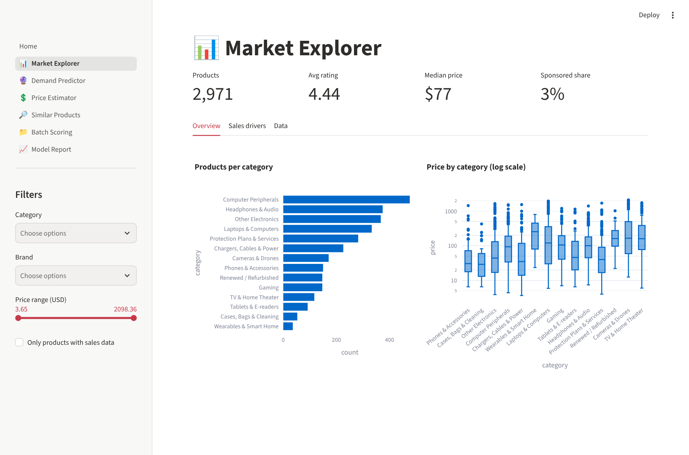
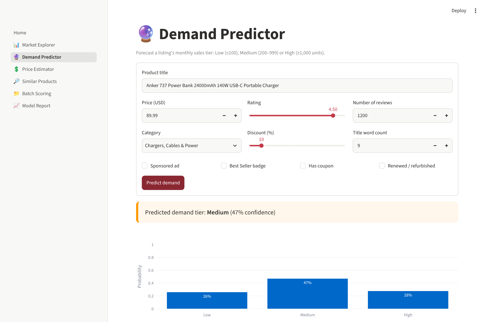
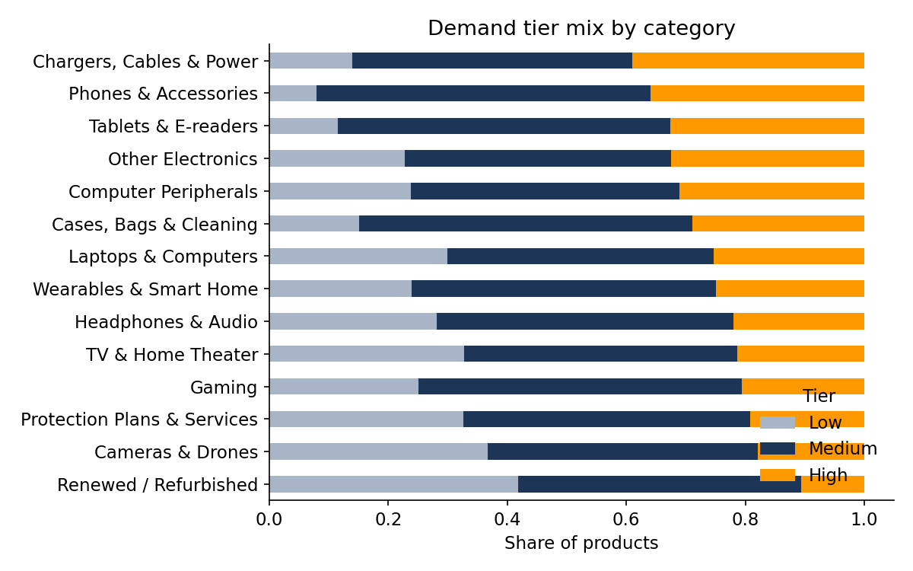
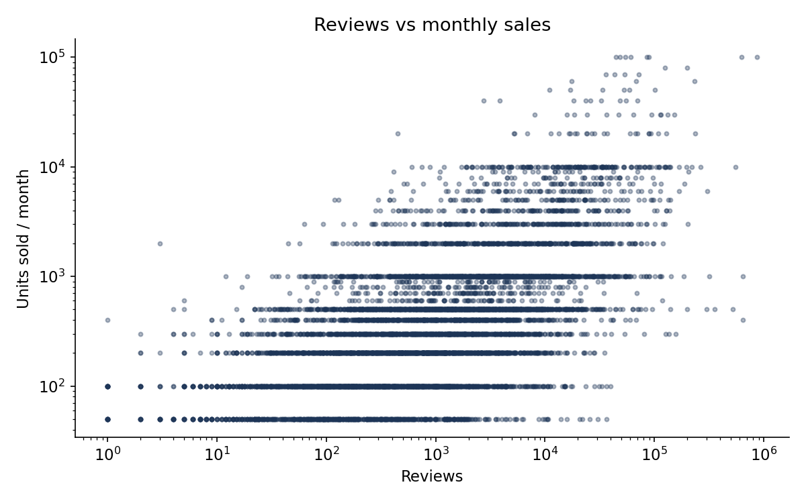

<div align="center">

# 🛒 Amz-Intelligence

**Amazon Business intelligence**
Clean messy listing data, explore the market, predict how well a product will sell, and sanity-check its price, all in an interactive Streamlit app.

[](https://github.com/AsadAli323/amz-intelligence/actions)
[](https://colab.research.google.com/github/AsadAli323/amz-intelligence/blob/main/notebooks/01_end_to_end.ipynb)
[](https://amz-intelligence.streamlit.app)


### [Try the live app → amz-intelligence.streamlit.app](https://amz-intelligence.streamlit.app)

</div>

## Why this project?
Sellers and analysts on large marketplaces constantly ask: *Will this product sell? Is it priced sensibly? Who am I competing against?* Amz-Intelligence turns ~42,000 raw, messy listing rows into answers to those questions.

## What the app does
| Page | What you get |
|---|---|
| 📊 **Market Explorer** | Filter by category, brand and price; see price spreads and what correlates with sales |
| 🔮 **Demand Predictor** | Enter a listing and get a Low / Medium / High monthly-sales forecast with probabilities |
| 💲 **Price Estimator** | Type a product title and get a model price estimate compared with its category |
| 🔎 **Similar Products** | Find the closest competing listings with TF-IDF text similarity |
| 📁 **Batch Scoring** | Upload your own CSV, score every row, download the results |
| 📈 **Model Report** | Metrics, baselines and limitations |

| Market Explorer | Demand Predictor |
|---|---|
|  |  |

## Key findings
Computed on the full cleaned data (8,819 unique products):

- Review count and sales move together (Spearman ρ ≈ 0.60), while **price and sales move in opposite directions** (ρ ≈ −0.55): cheaper products sell in larger volumes.
- Products carrying the **Best Seller** badge have a median of ~4,000 units/month versus ~400 for the rest.
- Sponsored placement alone shows **no difference** in median monthly sales in this snapshot.
- Accessories (chargers, cases, peripherals) have higher typical volumes than cameras, TVs and refurbished items.

<p align="center"> </p>

## Models and results
Both tasks use an 80/20 hold-out split (seed 42) and are compared against a naive baseline.

| Task | Best model | Result | Naive baseline |
|---|---|---|---|
| Demand tier (3 classes) | Random Forest | macro-F1 **0.62**, accuracy **0.62** | 0.48 accuracy (majority class) |
| Price estimate | Ridge on TF-IDF + features | MAE **≈ $80** (R² 0.79 on log price) | $157 MAE (predict the median) |

Full numbers for every candidate model are in [`reports/metrics.json`](reports/metrics.json). The models are useful but not magic: sales volume is reported in rounded buckets and this is a single-month snapshot. See *Limitations*.

## Data
~42,000 scraped electronics listings from August 2025, reduced to **8,819 unique products** after de-duplication. The raw table is messy: numbers stored as text (`"4.6 out of 5 stars"`, `"6K+ bought in past month"`), prices mixed with labels, repeated rows across scrape runs, and no category column. See [`data/README.md`](data/README.md) for the cleaning table, source and credit.

## Project structure
```
amz-intelligence/
├── app/                  # Streamlit multi-page app (Home.py + pages/)
├── src/Amz-Intelligence/       # cleaning.py, train.py (importable package)
├── notebooks/            # End-to-end Colab notebook
├── models/               # Trained pipelines (.joblib)
├── reports/              # metrics.json, figures, make_figures.py
├── data/                 # sample + data notes (raw data not committed)
├── tests/                # pytest unit tests for cleaning and labels
└── .github/workflows/    # CI
```

## Run it yourself
```bash
git clone https://github.com/AsadAli323/amz-intelligence.git
cd amz-intelligence
python -m venv .venv && source .venv/bin/activate   # Windows: .venv\Scripts\activate
pip install -r requirements.txt
streamlit run app/Home.py
```
The app works immediately with the bundled sample and pre-trained models.

**Retrain on the full data** (download it first, see `data/README.md`):
```bash
PYTHONPATH=src python -m Amz-Intelligence.train --raw data/raw/amazon_sales_data_uncleaned.csv
```
On Windows PowerShell use `$env:PYTHONPATH="src"` first. Or open the Colab notebook via the badge above.

**Run tests:** `pip install -r requirements-dev.txt && PYTHONPATH=src pytest`

## Limitations
- Sales volume is given in buckets (50+, 100+, 1K+ …), so the demand target is approximate.
- One snapshot in time: no seasonality or trend modelling.
- Categories come from keyword rules on titles and can misclassify ambiguous products.
- Review count partly reflects past sales, so it is a strong but somewhat circular predictor.
- The price model is a benchmark, not a pricing authority; errors are larger for expensive items.

## Roadmap
- Use product images and descriptions (multimodal features)
- Time-aware validation once multiple snapshots are available
- Explainability (SHAP) on the prediction pages

## Data source and credit
Dataset: *Amazon Product Sales Data – 42k Items (2025)* by srisyra02 on Kaggle, <https://www.kaggle.com/datasets/srisyra02/amazon-product-sales-data-42k-items-2025>. Check the dataset page for its license. All code, analysis, features, models and the app in this repository are original work.

## License
Code is released under the [MIT License](LICENSE).
